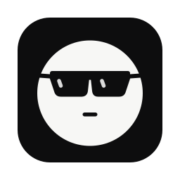

  

<h1 align="center">Agent Squad</h1>

  A macOS desktop for running a whole team of coding agents. 
  Each chat is a real <a href="https://docs.anthropic.com/en/docs/claude-code">Claude Code</a> session on your machine.

  <a href="https://agent-squad.app">agent-squad.app</a> ·
  <a href="https://github.com/rcosta02/agent-squad/releases/latest">Download for Mac</a>

---

This repository hosts the release builds of Agent Squad. The app is free to use; see [LICENSE](LICENSE).

Download the latest `.dmg` from [Releases](https://github.com/rcosta02/agent-squad/releases/latest) and drag it to Applications. Updates install automatically.

Versions 0.2.0 and earlier were released under GPL-3.0-or-later. Their source remains available under that license at the corresponding tags.

Bugs and feature requests: [Issues](https://github.com/rcosta02/agent-squad/issues).

Copyright © 2026 Rafael Costa.
